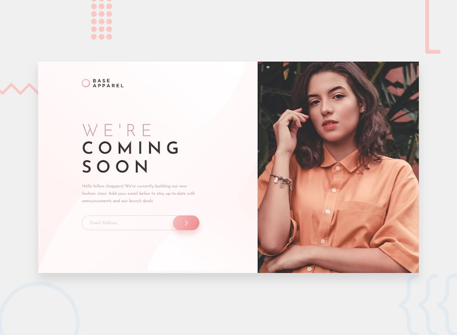

# Frontend Mentor - Base Apparel coming soon page

A responsive landing page built with HTML and CSS as part of a Frontend Mentor challenge.

Created desktop, tablet, and mobile layouts using CSS Grid and media queries.

Implemented responsive images using the <picture> element.

Styled the email subscription form with custom validation states and error messages.

Used the Josefin Sans font and matched the design in Figma.

Practiced responsive layouts, CSS positioning, and form styling.

